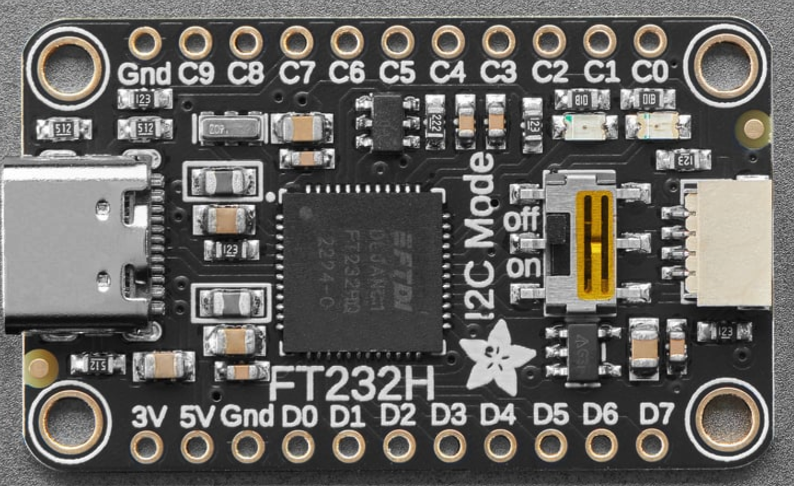
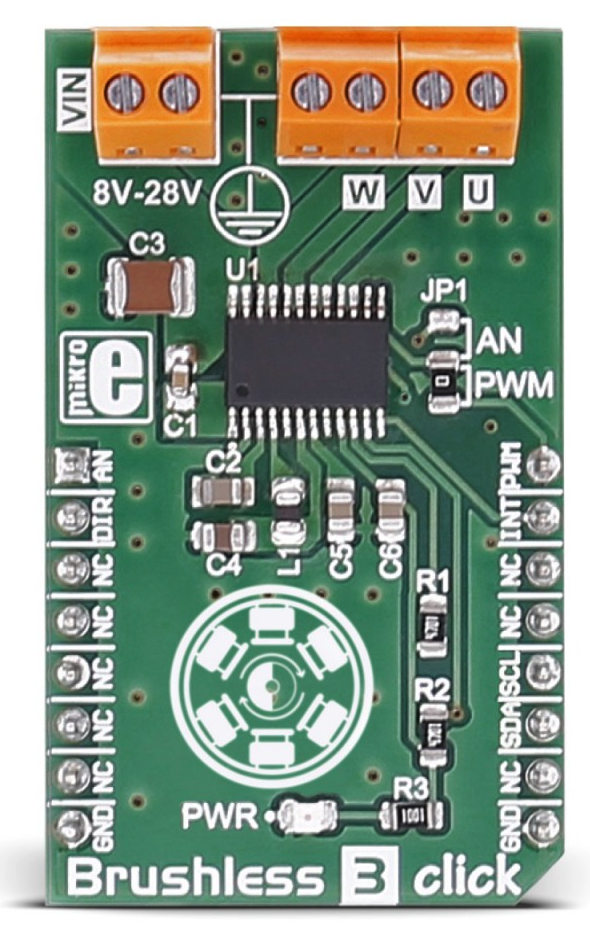
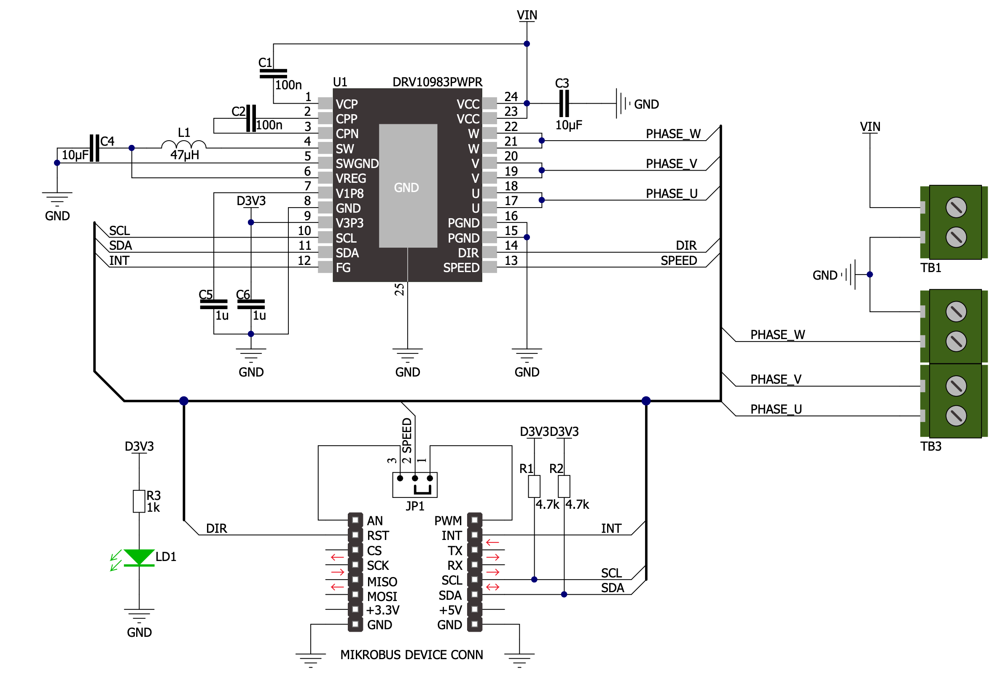

# drv10983_pyftdi

## About

This project was created to make it possible for the process of I2C configuration for DRV10983
to be more interactive and easier to adjust. Particularly, to avoid back and
forth adjust-compile-upload-run procedure that is needed when configuring with
the usage of a microcontroller.

This project consists of python script(s) that communicate with DRV10983 via I2C protocol directly from the computer (as opposed to programming MCU to do the communication)
with the help of [FT232H Single Channel HiSpeed USB to Multipurpose
UART/FIFO IC](https://ftdichip.com/products/ft232hq/).

Note: at this moment this just an example that you have to edit yourself to match your use case, but feel free to do so!

## Hardware used

### Adafruit FT232H Breakout board



Quote from [Adafruit product page](https://www.adafruit.com/product/2264?srsltid=AU7gw4VPSbyPTGV4dMZFCNj6aCBNQ1O6NhweIoQsHrA3PN9YfCYBQh4E):

> What can the FT232H chip do?  This chip from FTDI is similar to their USB to serial converter chips but adds a 'multi-protocol synchronous serial engine' which allows it to speak many common protocols like SPI, I2C, serial UART, JTAG, and more! 

### MIKROE Brushless Click 3 board



Schematic from [MIKROE site](https://download.mikroe.com/documents/add-on-boards/click/brushless-3/brushless-3-click-schematic.pdf):



## Credits

This project would not be possible without the great boards and code from [MikroElektronika](https://www.mikroe.com/), 
communication logic was inspired by the code from [mikroSDK 2.0 Click Repository](https://github.com/MikroElektronika/mikrosdk_click_v2/)

## Prerequisites

My test setup was Python 3.12.4 running on Windows 11. In order to set up PyFtdi,
I used instructions at [PyFtdi docs - windows section](https://eblot.github.io/pyftdi/installation.html#windows).

For motor, I used [BL4825O Mini 48mm Brushless Motor 12V from fascial gun](https://www.aliexpress.com/item/1005005818853197.html?spm=a2g0o.detail.pcDetailTopMoreOtherSeller.10.5ca13SKy3SKykX&gps-id=pcDetailTopMoreOtherSeller&scm=1007.40196.366991.0&scm_id=1007.40196.366991.0&scm-url=1007.40196.366991.0&pvid=17379b68-1217-4d14-ba5b-36b68dd73c48&_t=gps-id%3ApcDetailTopMoreOtherSeller%2Cscm-url%3A1007.40196.366991.0%2Cpvid%3A17379b68-1217-4d14-ba5b-36b68dd73c48%2Ctpp_buckets%3A668%232846%238108%231977&pdp_npi=4%40dis%21PLN%2130.99%2130.99%21%21%217.38%217.38%21%40211b431017355894369128880e66b8%2112000034460140343%21rec%21PL%211804596630%21XZ&utparam-url=scene%3ApcDetailTopMoreOtherSeller%7Cquery_from%3A).
As the name says, this motor requires around 12V to properly start. Also, it has relatively heavy outer rotor that needs
early switch from open to closed loop to avoid overcurrent protection lock.

## Connections

### FT232

- GND -> GND
- D0 -> SCL
- D1 -> SDA
- D1 -> D2

Also see this instructions from[Adafruit FT232H With SPI & I2C Devices](https://learn.adafruit.com/adafruit-ft232h-with-spi-and-i2c-libraries?view=all#i2c-devices):

Connect FT232H D1 and D2 together with a jumper wire.  This combined connection is the I2C SDA data line.
Add a 4.7 kilo-ohm resistor from the I2C SDA data line (pins D1 and D2 above) up to FT232H 5V.
Add a 4.7 kilo-ohm resistor from FT232H D0 up to FT232H 5V.  This pin D0 is the I2C SCL clock line.

NOTE: The resistors are already present on the Brushless 3 Click board, see the schematic.

## Installation

First, you need to have `uv` tool installed.

Example for mac:

```shell
brew install uv
```

### Create virtualenv:

```shell
uv venv
```

### Activate virtualenv

```shell
source .venv/bin/activate
```

### Install dependencies:

```shell
uv pip install -r requirements.txt
```

### Run:

```shell
uv run program_board.py
```

## Troubleshooting

### ValueError: No backend available

Probably libusb is not available. You need to install it on your OS. See [PyFtdi Troubleshooting](https://eblot.github.io/pyftdi/troubleshooting.html#error-no-backend-available)

Example for mac:

```shell
brew install libusb
```

### pyftdi.usbtools.UsbToolsError: No USB device matches URL ...

Make sure that your FT232H board is connected.

## Hardware

- [Brushless 3 Click - DRV10983 development board](https://www.mikroe.com/brushless-3-click)
- [Adafruit FT232H Breakout - General Purpose USB to GPIO, SPI, I2C](https://www.adafruit.com/product/2264)

## Resources

- [Brushless 3 Click product page](https://www.mikroe.com/brushless-3-click)
- [brushless.c - MikroElektronika embedded C implementation for DRV10983 communication](https://github.com/MikroElektronika/mikrosdk_click_v2/blob/master/clicks/DRV10983/lib_DRV10983/src/DRV10983.c)
- [DRV10983 product page](https://www.ti.com/product/DRV10983)
- [DRV10983 12- to 24-V, Three-Phase, Sensorless BLDC Motor Driver datasheet](https://www.ti.com/lit/ds/symlink/drv10983.pdf)
- [DRV10983 and DRV10975 Tuning Guide](https://www.ti.com/lit/ug/slou395d/slou395d.pdf?ts=1741189775252)
- [FT232H product page](https://ftdichip.com/products/ft232hq/)
- [FT232H Single Channel HiSpeed USB to Multipurpose
UART/FIFO IC datasheet](https://ftdichip.com/wp-content/uploads/2020/07/DS_FT232H.pdf)
